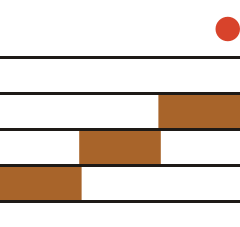
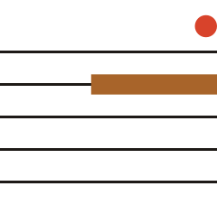

# The roast is written as a score · 焙火如樂譜

TONEROAST's signature is a **five-line stave that carries real roast data**. Five equal charcoal lines,
amber bars sitting on or between them like notes, and one ember-red dot above the top line.
It looks like a mark. It works like a chart. Every amber bar is a number.

That is the whole trick: **the logo, the roast-level label and the batch log are the same drawing,
read at three distances.**

| Reading | What you see | What it encodes | File |
| --- | --- | --- | --- |
| **Symbol** (brand) | 3 equal bars stepping up through the lower three spaces, top space empty, ember top-right | A roast that climbs round by round, and the room left above it (餘地) | `agent/visual/assets/logos/symbol-*.svg` |
| **Level** (product) | 1 bar sitting **on line n**, counted from the bottom | 焙度 n — 1 light, 5 deepest charcoal | `assets/logos/level-{1..5}*.svg` |
| **Score** (batch) | One bar per round: on the line of that round's intensity, width ∝ its hours; rests as fixed gaps labelled `歇 n 日` | The actual roast log of 焙次 No. ### | `product/components/stave.js` → `TR.score()`, `poster.html` |

 

## Why it is the signature

Everything else is held back on purpose: a paper-coloured ground, one serif for Chinese, a mono for
numbers, no photography required, no rounded corners, no shadows. The stave is where the brand spends
its personality, and it spends it on information.

It also carries the argument from `agent/verbal/positioning.md`: the roast is **logged, not mythologised**.
Coffee drinkers already read a roast curve; this is the same idea drawn as a score, not as a graph.

What it replaces: the category's leaves, mountains, teapots, steam, ink-wash and calligraphy. Without the
stave, a TONEROAST surface is just a tasteful beige tea label. With it, it is recognisable from a crop.

## Where it lives

| Piece | Path |
| --- | --- |
| Geometry (every number) | `agent/visual/visual-system.json` → `mark`, `score` |
| Symbol, level marks, lockups, clear space | `agent/visual/brandmark.md`, `assets/logos/` |
| The stave as a layout grid and the Roast Score | `agent/visual/graphic-elements.md`, `agent/visual/layout.md` |
| How it moves (Stave → Note → Ember) | `agent/visual/motion.md`, `motion.json`, `product/components/motion-unit.html` |
| Code that draws it | `product/components/stave.js` |
| The anchor image for models | `agent/visual/assets/anchor/anchor.png` |

## The rules that keep it working

- **Every amber bar is a number.** If you cannot say which number a bar encodes (a level, a round), delete it.
  No bars "for balance", no amber stripes as decoration.
- **Always five lines.** Equal weight, equal gap, perfectly straight and horizontal. Never 4, 6 or 7.
  (A 7-line version from an early AI board is retired; do not revive it.)
- **Level is position, only.** 焙度 n = bar on line n from the bottom. Do not recolour, resize or
  re-shape the bar per level.
- **One ember per surface.** Exactly one ember-red dot, above the top line at the right end of the stave.
  If a stave with its ember is on the surface, any logo on the same surface is the wordmark or the mono
  symbol, so a second dot never appears. Ember never touches amber (they are 1.05:1 and merge).
- **The stave runs edge to edge.** On packaging, posters and social cards the five lines cross the whole
  surface into the bleed. Bars stay inside the margins, except the front-panel level bar, which may run off
  the right edge only.
- **Type sits on the lines.** When text shares a surface with the stave, its baseline or ink edge lands on a
  stave line: 焙曲 spans line 5 → line 2 in the lockup and TONEROAST sits on line 1; a big level numeral
  sits on line 1 with its cap height filling the stave (`typography.md` → numeral on the stave).
- **Drawn by code, never by a model.** Generate the stave from `stave.js` or the SVGs. Image models miscount
  lines and steps (our Exp09 boards came back with 6 or 7 lines from a 5-line prompt). In AI images, leave
  the stave out and composite it afterwards.
- **It is a score, not music clip art.** No clefs, note heads, flags, quavers, bar lines, piano keys, sound waves.
  No curved, wavy, tapered, hand-drawn or perspective-warped lines. No smoke or steam turning into lines.
- **Data first.** A score shows at most 12 rounds (`score.max_rounds_drawn`). Example data in this kit is
  fictional; on a real product, the score must come from the real roast log.

| Do | Don't |
| --- | --- |
| Draw `level-4.svg` on a 焙度 4 tin | Make level 5 tins darker or the bar thicker |
| One ember, top-right of the stave | An ember on the stave **and** one in the logo |
| Stave lines bleed off both edges | A boxed stave floating in a frame |
| Score bar widths from real hours | Bars sized to "look nice" |
| AI base image with no lines, stave composited in code | Asking a model for "five horizontal lines with orange bars" |
| Numeral standing on line 1 | Numeral floating centred between lines |

## Getting it right the first time

Start from the data, not the layout: which batch, which level, how many rounds and rests. Draw the stave from
code at the format's gap (`--stave-gap-*`). Then hang the type on its lines. Then count: five lines, one ember,
every amber bar explained. Only then decide whether the surface needs anything else. It usually does not.
