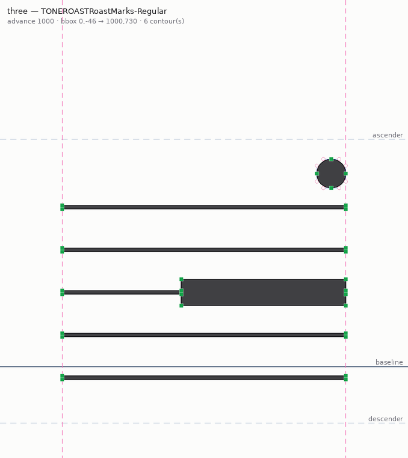
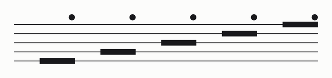

### 1. ff_status {}
```
{
  "pong": true,
  "fontforge": "20251009",
  "python": "3.10.12",
  "open_fonts": [],
  "active": null,
  "has_spiro": true,
  "workspace": "/workspace/tutorial-tests/98/work",
  "ffpython": "/workspace/tools/ffpython"
}
```

### 2. ff_new_font {"family": "TONEROAST Roast Marks", "style": "Regular"}
```
{
  "handle": "font1",
  "em": 1000,
  "ascent": 800,
  "descent": 200,
  "fontname": "TONEROASTRoastMarks-Regular"
}
```

### 3. ff_import_svg_folder {"folder": "svg", "start_codepoint": 57344}
```
{
  "imported": 5,
  "range": "U+E000..U+E004",
  "glyphs": [
    {
      "file": "level_1.svg",
      "glyph": "level_1",
      "codepoint": "U+E000",
      "char": ""
    },
    {
      "file": "level_2.svg",
      "glyph": "level_2",
      "codepoint": "U+E001",
      "char": ""
    },
    {
      "file": "level_3.svg",
      "glyph": "level_3",
      "codepoint": "U+E002",
      "char": ""
    },
    {
      "file": "level_4.svg",
      "glyph": "level_4",
      "codepoint": "U+E003",
      "char": ""
    },
    {
      "file": "level_5.svg",
      "glyph": "level_5",
      "codepoint": "U+E004",
      "char": ""
    }
  ]
}
```

### 4. ff_import_svg {"glyph": "one", "svg_path": "svg/level_1.svg", "width": 1000}
```
{
  "name": "one",
  "unicode": 49,
  "width": 1000,
  "lsb": 0.0,
  "rsb": 0.0,
  "contours": 7,
  "references": [],
  "bbox": [
    0.0,
    -85.8330078125,
    1000.0,
    730.0
  ],
  "worth_outputting": true
}
```

### 5. ff_import_svg {"glyph": "two", "svg_path": "svg/level_2.svg", "width": 1000}
```
{
  "name": "two",
  "unicode": 50,
  "width": 1000,
  "lsb": 0.0,
  "rsb": 0.0,
  "contours": 7,
  "references": [],
  "bbox": [
    0.0,
    -45.8330078125,
    1000.0,
    730.0
  ],
  "worth_outputting": true
}
```

### 6. ff_import_svg {"glyph": "three", "svg_path": "svg/level_3.svg", "width": 1000}
```
{
  "name": "three",
  "unicode": 51,
  "width": 1000,
  "lsb": 0.0,
  "rsb": 0.0,
  "contours": 7,
  "references": [],
  "bbox": [
    0.0,
    -45.8330078125,
    1000.0,
    730.0
  ],
  "worth_outputting": true
}
```

### 7. ff_import_svg {"glyph": "four", "svg_path": "svg/level_4.svg", "width": 1000}
```
{
  "name": "four",
  "unicode": 52,
  "width": 1000,
  "lsb": 0.0,
  "rsb": 0.0,
  "contours": 7,
  "references": [],
  "bbox": [
    0.0,
    -45.8330078125,
    1000.0,
    730.0
  ],
  "worth_outputting": true
}
```

### 8. ff_import_svg {"glyph": "five", "svg_path": "svg/level_5.svg", "width": 1000}
```
{
  "name": "five",
  "unicode": 53,
  "width": 1000,
  "lsb": 0.0,
  "rsb": 0.0,
  "contours": 7,
  "references": [],
  "bbox": [
    0.0,
    -45.8330078125,
    1000.0,
    730.0
  ],
  "worth_outputting": true
}
```

### 9. ff_clean_glyph {}
```
{
  "cleaned": 10,
  "glyphs": [
    "level_1",
    "level_2",
    "level_3",
    "level_4",
    "level_5",
    "one",
    "two",
    "three",
    "four",
    "five"
  ]
}
```

### 10. ff_validate {}
```
{
  "problem_count": 10,
  "problems": [
    {
      "glyph": "level_1",
      "state": 524289,
      "issues": [
        "non-integral coordinates (TrueType requires integers)"
      ]
    },
    {
      "glyph": "level_2",
      "state": 524289,
      "issues": [
        "non-integral coordinates (TrueType requires integers)"
      ]
    },
    {
      "glyph": "level_3",
      "state": 524289,
      "issues": [
        "non-integral coordinates (TrueType requires integers)"
      ]
    },
    {
      "glyph": "level_4",
      "state": 524289,
      "issues": [
        "non-integral coordinates (TrueType requires integers)"
      ]
    },
    {
      "glyph": "level_5",
      "state": 524289,
      "issues": [
        "non-integral coordinates (TrueType requires integers)"
      ]
    },
    {
      "glyph": "one",
      "state": 524289,
      "issues": [
        "non-integral coordinates (TrueType requires integers)"
      ]
    },
    {
      "glyph": "two",
      "state": 524289,
      "issues": [
        "non-integral coordinates (TrueType requires integers)"
      ]
    },
    {
      "glyph": "three",
      "state": 524289,
      "issues": [
        "non-integral coordinates (TrueType requires integers)"
      ]
    },
    {
      "glyph": "four",
      "state": 524289,
      "issues": [
        "non-integral coordinates (TrueType requires integers)"
      ]
    },
    {
      "glyph": "five",
      "state": 524289,
      "issues": [
        "non-integral coordinates 
```

### 11. ff_clean_glyph {"round_coords": true}
```
{
  "cleaned": 10,
  "glyphs": [
    "level_1",
    "level_2",
    "level_3",
    "level_4",
    "level_5",
    "one",
    "two",
    "three",
    "four",
    "five"
  ]
}
```

### 12. ff_validate {}
```
{
  "problem_count": 0,
  "problems": []
}
```

### 13. ff_preview {"mode": "outline", "glyph": "three"}
```
Outline of 'three' with control points and guides.  (678×760 px, 24 KB)
```


### 14. ff_preview {"mode": "sheet"}
```
Sheet with 10 glyphs.  (1152×96 px, 9 KB)
```


### 15. ff_preview {"mode": "text", "text": "12345", "size": 120}
```
Text '12345' rendered at 120pt.  (656×154 px, 4 KB)
```


### 16. ff_generate {"path": "TONEROAST-RoastMarks.ttf"}
```
{
  "generated": "/workspace/tutorial-tests/98/work/TONEROAST-RoastMarks.ttf",
  "bytes": 2868,
  "sfd": "/workspace/tutorial-tests/98/work/TONEROAST-RoastMarks.sfd"
}
```

### 17. ff_generate {"path": "TONEROAST-RoastMarks.woff2", "also_sfd": false}
```
{
  "generated": "/workspace/tutorial-tests/98/work/TONEROAST-RoastMarks.woff2",
  "bytes": 900,
  "via": "fontTools (woff2)"
}
```

### 18. ff_inspect_binary {"path": "TONEROAST-RoastMarks.ttf"}
```
{
  "path": "/workspace/tutorial-tests/98/work/TONEROAST-RoastMarks.ttf",
  "bytes": 2868,
  "sfnt": "\u0000\u0001\u0000\u0000",
  "flavor": null,
  "tables": [
    "FFTM",
    "GlyphOrder",
    "OS/2",
    "cmap",
    "cvt ",
    "gasp",
    "glyf",
    "head",
    "hhea",
    "hmtx",
    "loca",
    "maxp",
    "name",
    "post"
  ],
  "unitsPerEm": 1000,
  "numGlyphs": 13,
  "os2": {
    "weightClass": 400,
    "widthClass": 5,
    "fsType": 0,
    "typoAscender": 800,
    "typoDescender": -200,
    "capHeight": 0,
    "xHeight": 0
  },
  "names": {
    "copyright": "",
    "family": "TONEROAST Roast Marks",
    "subfamily": "Regular",
    "full": "TONEROAST Roast Marks Regular",
    "version": "Version 0.001",
    "postscript": "TONEROASTRoastMarks-Regular"
  },
  "cmap": {
    "count": 15,
    "sample": [
      "U+0000",
      "U+0008",
      "U+0009",
      "U+000D",
      "U+001D",
      "U+0031",
      "U+0032",
      "U+0033",
      "U+0034",
      "U+0035",
      "U+E000",
      "U+E001",
      "U+E002",
      "U+E003",
      "U+E004"
    ]
  }
}
```
